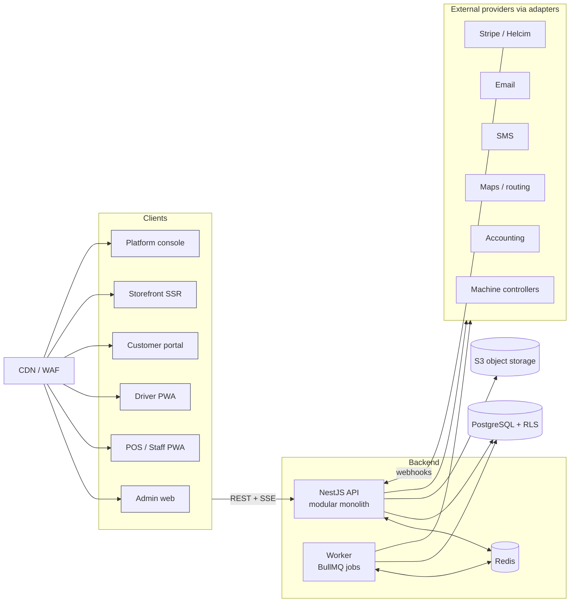
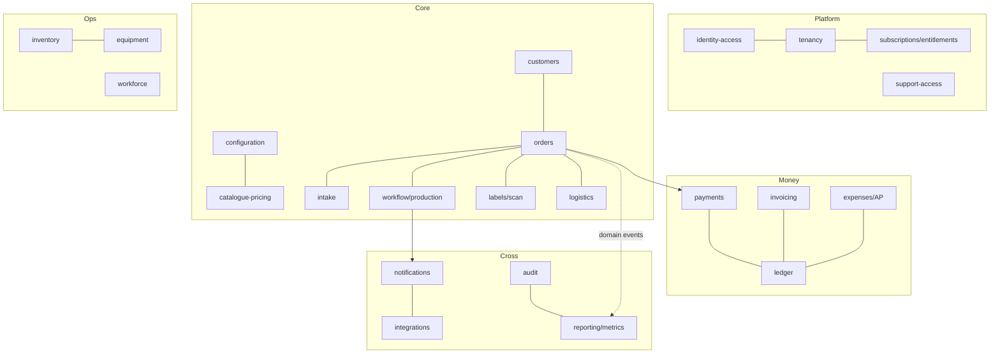
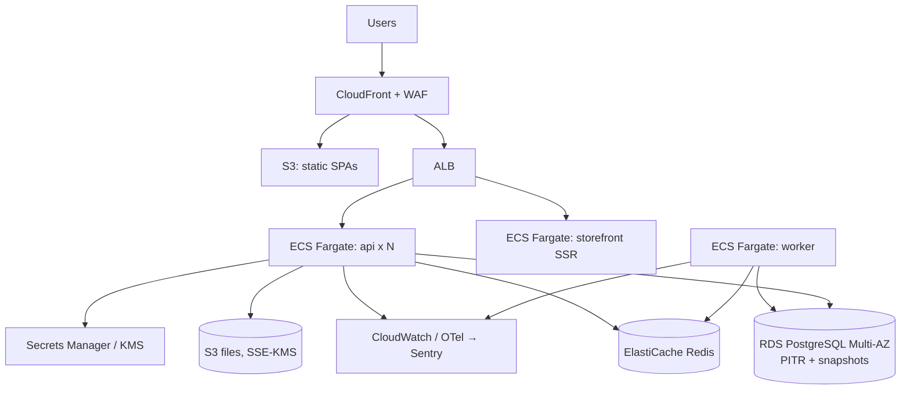

# 04 — System, Integration & Deployment Architecture

## 1. Style: modular monolith
One NestJS codebase, one deployable API, domain modules with enforced boundaries (no cross-module DB access; modules talk via exported services and domain events). A separate **worker** process (same codebase, different entrypoint) runs BullMQ jobs. **Reason:** one team, strong transactional needs (orders+payments+ledger), lowest ops cost; boundaries make later extraction possible.

## 2. Context diagram



## 3. Module map (API)



**Rules:** (1) controllers → application services → repositories; (2) cross-module calls only through exported service interfaces; (3) modules publish domain events via a transactional **outbox** (reliable notifications, metrics, integration sync); (4) lint rule (`dependency-cruiser`) enforces boundaries in CI.

## 4. Key technical decisions (ADR summary)
| ADR | Decision | Reason |
|---|---|---|
| 001 | Modular monolith + worker | See §1 |
| 002 | PostgreSQL single DB, shared schema, `tenant_id` + RLS | Cost-efficient, strong isolation with RLS; schema-per-tenant rejected (migration cost at scale); DB-per-tenant reserved for Enterprise option |
| 003 | **Drizzle ORM** + SQL-first migrations (drizzle-kit, hand-authored RLS SQL) | Prisma's connection model makes `SET LOCAL app.tenant_id` per transaction awkward and RLS unsupported in schema; Drizzle is closer to SQL, supports raw/tx cleanly. Fallback: Kysely. |
| 004 | REST + OpenAPI generated from Zod via `nestjs-zod`; typed client generated for frontends | Single source of truth for validation |
| 005 | SSE for live updates (production board, dispatch); WebSocket only if bidirectional need | Simpler, proxy-friendly |
| 006 | Outbox pattern for events/integrations | At-least-once reliability, no dual-write |
| 007 | Money = `bigint` minor units + `currency char(3)`; arithmetic in a shared `money` package (integer / decimal.js for tax rates) | No floats |
| 008 | Sessions: opaque server-side session ids in httpOnly SameSite cookies for browser apps (CSRF token for unsafe methods); short-lived JWT only for service-to-service | Revocable, no token-in-localStorage |
| 009 | Storefront separate SSR app (Next.js) | SEO + custom domains (D3) |
| 010 | Region AWS `ca-central-1` | Canadian privacy expectations |
| 011 | Monorepo with pnpm workspaces + Turborepo | Fast CI, shared packages |

## 5. Request lifecycle & tenant context

```mermaid
sequenceDiagram
  participant B as Browser
  participant G as Auth guard
  participant T as Tenant context
  participant S as Service
  participant D as Postgres
  B->>G: request + session cookie
  G->>G: resolve session → user, memberships
  G->>T: pick active membership (validated, not client-supplied)
  T->>D: BEGIN; SET LOCAL app.tenant_id, app.user_id, app.branch_ids
  S->>D: queries (RLS enforced)
  D-->>S: rows only for tenant
  S-->>B: response
  T->>D: COMMIT
```
Active tenant derives from the **session's membership**; a client may *request* switching memberships (e.g., owner with two businesses) but the server verifies membership. See 06.

## 6. Integration architecture
Each provider has a TS interface + adapter + contract test + sandbox test + fake for CI.

| Capability | Interface | First adapter | Notes |
|---|---|---|---|
| Payments | `PaymentProvider` (createIntent, capture, refund, parseWebhook, onboardMerchant) | Stripe (Connect) | Helcim later. Idempotency keys; webhook signature verified; events stored then processed idempotently |
| Email | `EmailProvider` | AWS SES (or Postmark) | Bounce/complaint webhooks → suppression list |
| SMS | `SmsProvider` | Twilio | CASL consent required; opt-out keyword handling |
| Maps | `MapProvider` (geocode, distance matrix, route optimize) | Google Maps | Cache geocodes within terms; no invented ETAs |
| Accounting | `AccountingExport` | CSV/QBO IIF-compatible export first | Sync later |
| Storage | `ObjectStore` | S3 / MinIO local | Pre-signed upload; MIME sniffing |
| Machines | `MachineController` | none at launch (manual) | Vendor-specific, later |
| Billing (platform) | `BillingProvider` | Stripe Billing | Separate from tenant payment accounts |

**Integration log table** records every outbound call (redacted), status, latency, retries. A "provider status" never shows **connected** unless a live connection test succeeded.

Credentials: stored encrypted (AES-256-GCM, envelope keys in AWS KMS), never returned by the API after save.

## 7. Background jobs (BullMQ)
Outbox dispatcher · notification sending · webhook processing · SLA sweeps (deadline risk/overdue) · recurring booking generation · scheduled reports · invoice runs · subscription lifecycle · retention/deletion · export generation · inventory alerts. All jobs: idempotent, retry with exponential backoff, dead-letter queue visible in admin tooling, tenant context re-established from job payload (never ambient).

## 8. Deployment architecture (AWS-ready)


- Environments: local (docker-compose: Postgres, Redis, MinIO, Mailpit) → dev → staging → prod; prod has separate AWS account.
- Infra as code: Terraform (infrastructure/deployment). Blue/green or rolling deploys; DB migrations run as a pre-deploy job using **expand/contract** (backward compatible).
- Backups: RDS PITR (35 d), daily snapshot copy to a second region; S3 versioning + replication; quarterly restore drill (Test 10).
- DB roles: `app_owner` (migrations, bypass RLS only for migration), `app_rw` (RLS enforced, used by API/worker), `app_platform` (limited, platform-level tables), `app_ro_reporting` (RLS enforced). The API **never** connects as a role with BYPASSRLS.
- Custom domains: DNS TXT verification → ACM/Caddy-managed certs → host→tenant mapping table at the edge.
- Observability: structured JSON logs w/ request id + tenant id (no PII), OpenTelemetry traces, Sentry, per-tenant metrics, uptime checks, alerting to on-call.
- Targets (initial hypotheses): API p95 < 300 ms, availability 99.9 %, RPO ≤ 5 min, RTO ≤ 4 h.

## 9. Performance & scale notes
Hot tables partitioned by month when needed (`order_events`, `audit_logs`, `ledger_entries`, `integration_logs`) — **not at launch**. Reporting reads via read replica + materialized/rollup tables when query cost justifies. Composite indexes lead with `tenant_id`.

## 10. Offline & print
Staff PWA caches catalogue/customer-lite data; queues intake/stage-scan actions with client-generated UUIDs and idempotency keys; conflicts resolved server-side by event ordering. Payments **cannot** be taken offline except cash recorded as pending-sync. Printing: browser print (receipt CSS, 80 mm) at launch; optional local print agent for ZPL/ESC-POS later.
