# 05 — Database ERD and Relational Schema Proposal

PostgreSQL 16. Conventions apply to all tables unless stated.

## Conventions
- PK: `id uuid` (UUIDv7, time-ordered). Public references (order number) are separate human-readable columns.
- Every tenant-owned table: `tenant_id uuid NOT NULL` (FK, indexed as the leading column of composite indexes); branch-owned: `branch_id uuid`.
- Composite FKs include `tenant_id` (e.g., `FOREIGN KEY (tenant_id, customer_id) REFERENCES customers(tenant_id, id)`) so a row can **never** reference another tenant's row, even if application code is wrong.
- Timestamps `timestamptz` in UTC: `created_at`, `updated_at`; branch time zone in `branches.timezone` (IANA). Financial "business date" stored as `date` computed at posting using branch tz.
- Money: `amount_minor bigint` + `currency char(3)`; tax rates `numeric(9,6)`; weights `numeric(10,3)` + unit stored canonical in grams (`weight_g integer`).
- Soft-delete only where legally/operationally required (`archived_at`); financial and event tables are **append-only** (enforced by triggers denying UPDATE/DELETE).
- Optimistic concurrency: `version int` on mutable aggregates (orders, bookings).
- Enums as `text` + CHECK or lookup tables (easier migrations than PG enums).
- RLS: `ENABLE` + `FORCE ROW LEVEL SECURITY` on every tenant table; policy `USING (tenant_id = current_setting('app.tenant_id')::uuid)` plus branch policies for branch-restricted tables (06).

## ERD (core)

```mermaid
erDiagram
  TENANTS ||--|| ORGANIZATIONS : has
  TENANTS ||--o{ SUBSCRIPTIONS : has
  SUBSCRIPTION_PLANS ||--o{ SUBSCRIPTIONS : defines
  SUBSCRIPTION_PLANS ||--o{ PLAN_ENTITLEMENTS : grants
  TENANTS ||--o{ BRANCHES : operates
  TENANTS ||--o{ USER_MEMBERSHIPS : has
  USERS ||--o{ USER_MEMBERSHIPS : joins
  ROLES ||--o{ USER_MEMBERSHIPS : assigned
  ROLES ||--o{ ROLE_PERMISSIONS : contains
  PERMISSIONS ||--o{ ROLE_PERMISSIONS : in
  USER_MEMBERSHIPS ||--o{ MEMBERSHIP_BRANCHES : scoped
  BRANCHES ||--o{ MEMBERSHIP_BRANCHES : allows
  USER_MEMBERSHIPS ||--o| EMPLOYEES : is
  TENANTS ||--o{ CUSTOMERS : owns
  CUSTOMERS ||--o{ CUSTOMER_ADDRESSES : has
  CUSTOMERS ||--o{ CUSTOMER_CONSENTS : gives
  CUSTOMERS }o--o| COMMERCIAL_ACCOUNTS : belongs
  SERVICE_CATEGORIES ||--o{ SERVICES : groups
  SERVICES ||--o{ SERVICE_PRICES : priced
  PRICE_LISTS ||--o{ SERVICE_PRICES : contains
  BRANCHES ||--o{ ORDERS : receives
  CUSTOMERS ||--o{ ORDERS : places
  ORDERS ||--o{ ORDER_LINES : contains
  SERVICES ||--o{ ORDER_LINES : snapshot
  ORDERS ||--o{ ORDER_ITEMS_INSPECTED : inspected
  ORDER_LINES ||--o{ GARMENT_RECORDS : tracks
  ORDERS ||--o{ ORDER_EVENTS : history
  WORKFLOW_DEFINITIONS ||--o{ WORKFLOW_STAGES : has
  ORDERS }o--|| WORKFLOW_DEFINITIONS : follows
  ORDERS ||--o{ WORK_ASSIGNMENTS : assigned
  ORDERS ||--o{ QUALITY_INSPECTIONS : checked
  ORDERS ||--o{ BOOKINGS : fulfils
  BOOKINGS ||--o{ DELIVERY_TASKS : creates
  DRIVERS ||--o{ DELIVERY_TASKS : performs
  DELIVERY_TASKS ||--o{ DELIVERY_EVENTS : history
  DELIVERY_TASKS ||--o| DRIVER_PAY_CALCULATIONS : pays
  ORDERS ||--o{ PAYMENT_ALLOCATIONS : settled_by
  PAYMENTS ||--o{ PAYMENT_ALLOCATIONS : allocated
  PAYMENTS ||--o{ REFUNDS : reversed_by
  INVOICES ||--o{ INVOICE_LINES : contains
  INVOICES ||--o{ PAYMENT_ALLOCATIONS : settled_by
  LEDGER_ACCOUNTS ||--o{ LEDGER_ENTRIES : posted
  LEDGER_TRANSACTIONS ||--o{ LEDGER_ENTRIES : balanced
  SUPPLIERS ||--o{ PURCHASE_ORDERS : receives
  PURCHASE_ORDERS ||--o{ GOODS_RECEIPTS : fulfilled
  INVENTORY_ITEMS ||--o{ STOCK_MOVEMENTS : moves
  MACHINES ||--o{ MAINTENANCE_RECORDS : serviced
  MACHINES ||--o{ DOWNTIME_EVENTS : down
  MACHINES ||--o{ MACHINE_SESSIONS : used
```

## Schema by domain (tables, key columns, constraints)

### Platform (no tenant_id; platform-only role)
| Table | Notes |
|---|---|
| `tenants` | id, slug (unique), status (`trial|active|past_due|suspended|cancelled|offboarding`), data_region, created_at |
| `subscription_plans` | code, name, interval, price_minor, currency, is_public, version |
| `plan_entitlements` | plan_id, key (`max_branches`, `max_staff`, `module.delivery`…), value_json |
| `subscriptions` | tenant_id, plan_id, status, trial_ends_at, current_period_start/end, cancel_at, billing_provider_ref |
| `tenant_entitlement_overrides` | tenant_id, key, value, reason, expires_at, set_by |
| `usage_records` | tenant_id, metric, period, value (entitlement counters, no metered billing) |
| `feature_flags`, `platform_announcements`, `platform_users` | platform staff identities, separate from tenant users |
| `support_access_grants` | tenant_id, granted_by, platform_user_id, scope, reason, starts_at, expires_at, revoked_at |
| `custom_domains` | tenant_id, hostname unique, verified_at, tls_status |

### Identity (mixed)
- `users` (global login identity): email citext unique, password_hash (argon2id), mfa fields, status.
- `user_memberships`: tenant_id, user_id, role_id, status, UNIQUE(tenant_id,user_id) — the **only** path from a user to a tenant.
- `membership_branches`: membership → branches (empty = none; `all_branches` flag explicit).
- `roles` (tenant_id NULL for system templates; tenant-copy on tenant create), `permissions` (system catalogue, code like `order.refund.approve`), `role_permissions`.
- `permission_limits`: role_id, permission, `max_amount_minor` (discount/refund thresholds).
- `employees`: membership_id, employee_no, pay data, hire dates (HR PII separated, restricted permission).
- `sessions`: id hash, user_id, active_membership_id, ip/ua, expires_at, revoked_at. `mfa_credentials`, `password_resets`, `api_keys` (tenant_id, hashed, scopes).
- `customer_auth_identities`: tenant_id, customer_id, login credentials for portal (customer login is tenant-scoped).

### Organization & configuration
`organizations` (legal name, tax ids (GST# etc.), country, default currency, locale), `branches` (address, timezone, hours, order_number_seq), `business_hours`, `holidays`, `tax_jurisdictions` + `tax_rates` (effective-dated; seeded: CA-AB GST 5 %), `config_entries` (scope `global|tenant|branch`, scope_id, key, value_json, version, effective_from, created_by) — **config is append-versioned**, resolution = branch → tenant → global default (06/ADR).

### Customers
`customers` (type `individual|guest|commercial_contact`, name, email citext, phone E.164, commercial_account_id, loyalty_tier, marketing_status, archived_at; unique partial indexes on (tenant_id, lower(email)) and (tenant_id, phone) where not null), `customer_addresses` (Canadian fields, geocode lat/lng + provenance, delivery_instructions), `customer_preferences`, `customer_consents` (purpose, granted, source, ip, timestamp; append-only), `customer_tags`, `customer_notes`.

### Catalogue & pricing
`service_categories`, `services` (pricing_model `per_kg|per_item|fixed|bundle`, workflow_definition_id, tax_category, requires_garment_tracking, is_express_capable), `price_lists` (kind `standard|contract|customer`, owner ref, effective range), `service_prices` (price_list_id, service_id, branch_id nullable, amount_minor, min_charge_minor, tiers_json), `price_rules` (conditions/effect json, priority), `discounts` (code, type, value, approval rule), `bundles`/`bundle_items`.

### Orders
- `orders`: tenant_id, branch_id, order_no (unique per tenant: `branch_code-seq`), customer_id, status (derived coarse: `draft|open|ready|completed|cancelled`), current_stage_id, promised_at, express bool, source (`pos|portal|storefront|recurring|api`), subtotal_minor, discount_minor, tax_minor, delivery_fee_minor, total_minor, currency, balance_due_minor (maintained via ledger triggers/service — see 08), idempotency_key unique, version.
- `order_lines`: service snapshot (service_id, name, pricing_model, unit_price_minor, qty, weight_g, line_total_minor, tax breakdown json, **price_list_version / rule trace**) — immutable after finalization; amendments are new lines/adjustment records.
- `order_inspections` + `inspection_findings` + `media_assets` (damage/stain/photo). `garment_records` (tag_code unique, category, colour, fabric, care, status) when tracking enabled.
- `order_events` (append-only): order_id, type, from_stage_id, to_stage_id, actor_user_id, branch_id, occurred_at, note, media refs, payload json.
- `order_adjustments` (post-finalization changes with reason/approver).

### Production
`workflow_definitions` (version, service_ids), `workflow_stages` (key, sequence, required_permission, expected_minutes, requires_checklist, requires_approval, is_terminal), `workflow_transitions` (from, to, conditions, kind `normal|rework|exception`), `stage_checklists`, `work_assignments` (order_id, stage_id, assigned_to, status, started/completed), `quality_inspections` (result, reason_code, rework_stage_id, inspector, media), `rework_records`, `order_exceptions` (type `missing|damaged|wrong_qty|complaint|delay`, status, resolution), `production_records` (machine_id, load weight, durations).

### Logistics
`delivery_zones` (geometry/postal prefixes, fee_rule json, min_order_minor, free_over_minor), `bookings` (type pickup/delivery, window, address snapshot, recurrence_id), `recurrence_rules`, `drivers` (membership_id, vehicle), `delivery_tasks` (booking_id, driver_id, status, sequence, route_id), `delivery_routes`, `delivery_events` (append-only; with proof media, OTP verified flag, signature asset, GPS ping provenance), `location_pings` (only from real devices), `driver_pay_models`, `driver_pay_calculations` (inputs snapshot + formula version + result — independent of customer fee).

### Finance (see 08)
`payments` (method, status, amount_minor, provider, provider_ref unique per provider, idempotency_key, received_at, branch_id, shift_id), `payment_allocations` (payment → order/invoice, amount), `refunds` (payment_id, amount, reason, approved_by, status, provider_ref), `invoices` + `invoice_lines` (immutable once issued; credit notes for changes), `credit_notes`, `ledger_accounts` (chart; tenant-configurable codes), `ledger_transactions` (header: source type/id, business_date, posted_at, reverses_id), `ledger_entries` (transaction_id, account_id, debit_minor, credit_minor, currency; **CHECK per-transaction sum(debit)=sum(credit)** via deferred constraint trigger), `expenses`, `supplier_bills`, `cash_shifts`, `cash_movements`, `reconciliation_records`, `webhook_events` (provider, event_id unique → dedupe).

### Inventory / Equipment / Workforce / Engagement / Governance
Inventory: `inventory_items`, `inventory_locations`, `stock_movements` (append-only; qty delta, unit cost, reason), `suppliers`, `supplier_prices`, `purchase_orders(+items)`, `goods_receipts(+items, batch/expiry)`, `service_consumption_standards`.
Equipment: `equipment_categories`, `machines`, `machine_sessions`, `maintenance_schedules`, `maintenance_records`, `work_orders`, `downtime_events`.
Workforce: `shifts`, `attendance_records`, `leave_requests`, `commission_rules`, `commission_records`.
Engagement: `notification_templates`, `notifications` (channel, status, provider_ref, attempts, error), `notification_preferences`, `promotions`, `loyalty_accounts`, `loyalty_transactions` (append-only), `referrals`, `reviews`, `support_tickets(+messages)`.
Governance: `audit_logs` (append-only: actor, tenant, action, entity, before/after hash or diff, ip, request_id, via_support_grant_id), `data_exports`, `retention_policies`, `integration_connections` (encrypted creds ref), `integration_logs`, `outbox_events`, `idempotency_keys`, `report_definitions`, `saved_reports`, `kpi_targets`, `files` (S3 key, mime, size, sha256, scan_status).

## Indexing strategy (examples)
- `orders(tenant_id, branch_id, status, promised_at)` — production boards/overdue.
- `orders(tenant_id, customer_id, created_at desc)`; `orders(tenant_id, order_no)` unique.
- `order_events(tenant_id, order_id, occurred_at)`; `ledger_entries(tenant_id, account_id, business_date)`.
- `customers` trigram (pg_trgm) on name; unique partial on email/phone.
- `delivery_tasks(tenant_id, driver_id, scheduled_date)`; `payments(tenant_id, provider, provider_ref)` unique.

## Migration strategy
- drizzle-kit generates structural migrations; **RLS policies, triggers, constraints authored as reviewed SQL** in `database/migrations`.
- Forward-only, expand/contract, each migration tested against a snapshot DB in CI; `migrate` job runs pre-deploy with the owner role.
- CI check: every table with `tenant_id` must have RLS forced and a policy (automated catalog query — fails build otherwise).
- Seeds: system permissions, role templates, tax jurisdictions, default workflows, plan catalogue; **no demo data in production**; demo tenant seed only for dev/staging and flagged `is_demo`.

## Deliberate deviations from the brief's list
- `tenants`/`organizations` split (C1); `sessions` + `customer_auth_identities` tenant-scoped; `order_lines` instead of `order_items` (the latter reserved for intake item records); added outbox, idempotency, webhook, config versioning, cash shift, price-list tables that the brief implies but omits; `ledger_transactions` header added for balanced double entry.
