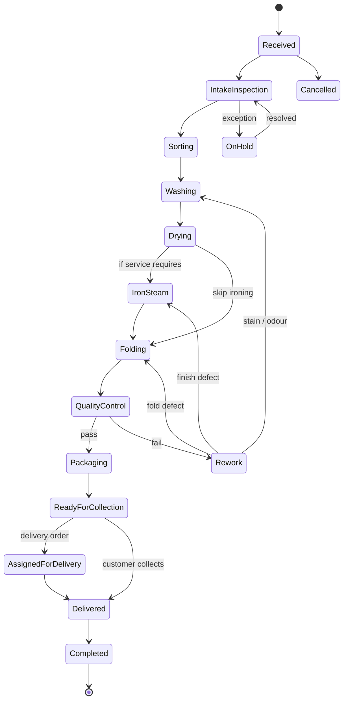
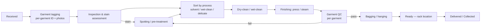
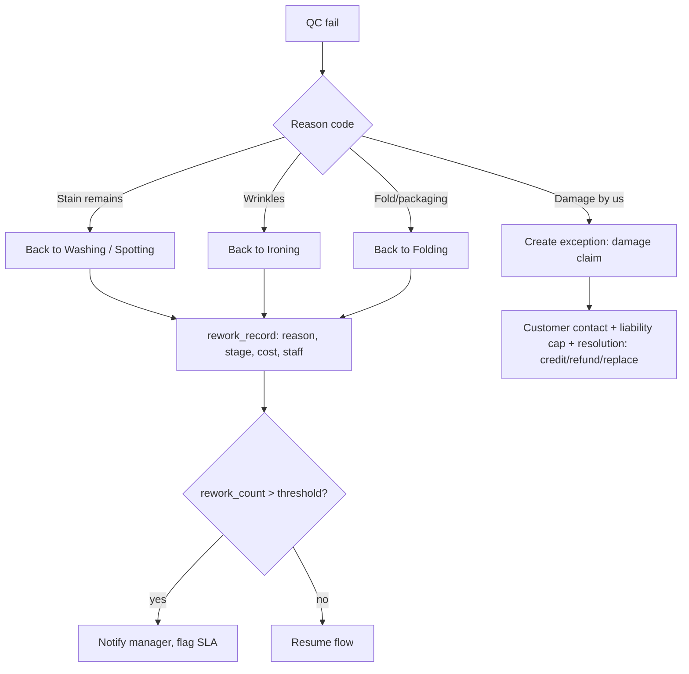

# 07 — Laundry Production Workflows

## 1. Engine model
- `workflow_definition` (versioned) → `workflow_stages` + `workflow_transitions`. A service references a definition; an order locks the **definition version at intake** so config changes never alter in-flight orders (unless migrated explicitly by a manager, audited).
- Each stage: key, sequence, `required_permission`, `expected_minutes`, optional checklist, optional approval gate, notification triggers, `is_terminal`.
- Transition = validated command `advance(order, to_stage, actor, note, media?)`: checks (a) transition exists, (b) actor permission + branch, (c) checklist complete, (d) optimistic `version`. Writes `order_events` row + updates `orders.current_stage_id` in one transaction; emits outbox event (notifications, metrics, SSE).
- Order SLA: `promised_at` = intake time + service turnaround (+ express rules), computed with branch hours/holidays; stage deadlines derived from `expected_minutes`.

## 2. Default flow (wash & fold / full-service)

## 3. Dry-cleaning / garment-care variant (differs materially)

Differences: garment-level IDs and status, mandatory pre-existing-damage capture with customer acknowledgement, spotting stage, per-garment QC, rack/hanger locations. Garment records progress independently; the order is "ready" when all garments are ready (or partial release if configured).

## 4. Self-service laundromat (no production workflow)
`Machine selected → payment → session started (manual or controller) → timer → session ended → (optional) revenue/utilization recorded`. Uses `machine_sessions`, not `order_events`.

## 5. Commercial/bulk variant
Counted/weighed bulk bags per client with **count reconciliation** at intake and at dispatch (variance report, SLA-driven), linen category flow (sort by item type → wash by formula → dry → fold → count → bundle per room/floor). Recurring order generation by schedule.

## 6. Rework & exceptions

Exception types: missing garment, damaged item, wrong quantity, customer complaint, production delay. Each has status (`open → investigating → resolved/closed`), owner, resolution record, optional financial adjustment (via approval flow in 08). Rework rate = reworked orders ÷ completed orders.

## 7. Events emitted (contract)
`order.received · order.stage_changed{from,to,actor,branch,at,note} · order.qc_failed · order.rework_started · order.ready · order.delivery_assigned · order.delivered · order.completed · order.cancelled · order.exception_opened/resolved · order.sla_at_risk · order.overdue`. Consumers: notifications, SSE boards, metrics rollups, integrations. Event payloads are versioned.

## 8. Scan-driven UX contract
`GET /scan/{code}` → authorized order card + allowed next actions for *this user's role at this branch*. Unauthorized/unknown codes return the same shape of error (no existence leak across branches/tenants).

## 9. Dashboards (derived from `orders`/`order_events`)
Per-stage counts, oldest-in-stage, overdue, due-in-2h, rework queue, by-branch filter, per-tech load. Live via SSE, with polling fallback; numbers reconcile with order list counts (tested).
