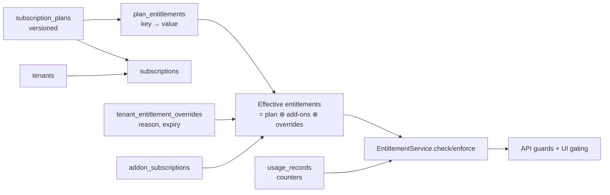
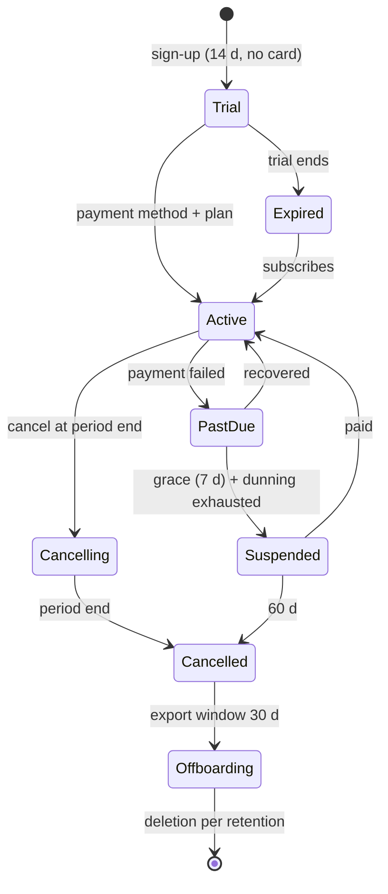

# 09 — SaaS Subscription & Entitlements Architecture

## 1. Model

- **Entitlement keys:** limits (`limit.branches`, `limit.staff_seats`, `limit.orders_per_month` (soft), `limit.storage_gb`), module booleans (`module.delivery`, `module.commercial`, `module.self_service`, `module.inventory`, `module.equipment`, `module.storefront_custom_domain`, `module.ai_assistant`), capability tiers (`reports.level`, `api.access`).
- Plans and entitlements are **data**: editable in the platform console, versioned; existing subscribers stay on their plan version until migrated (grandfathering).
- Draft plan matrix (hypothesis, not validated):

| | Starter $49 | Professional $99 | Business $179 | Enterprise |
|---|---|---|---|---|
| Branches | 1 | 2 | 5 | custom |
| Staff seats | 5 | 15 | 40 | custom |
| POS/orders/production | ✔ | ✔ | ✔ | ✔ |
| Customer portal + storefront | basic | ✔ | ✔ | ✔ |
| Pickup & delivery + driver app | — | ✔ | ✔ | ✔ |
| Inventory & equipment | — | ✔ | ✔ | ✔ |
| Commercial accounts & invoicing | — | add-on | ✔ | ✔ |
| BI & saved reports | basic | standard | advanced | custom |
| Custom domain | — | ✔ | ✔ | ✔ |
| AI assistant | — | — | add-on | ✔ |
| Integrations/API | — | limited | ✔ | custom/SLA |
Basic activities (creating orders, customers) are **not** metered. Annual = 2 months free (hypothesis). Payment processing: pass-through Stripe fees; optional platform application fee is a business decision (open question Q1).

## 2. Enforcement semantics (Test 9)
- Check at **creation** of the limited resource (`create branch`, `invite staff`), returning a structured `ENTITLEMENT_EXCEEDED` with upgrade hint.
- **Never** destroy or hide existing records when over a limit (downgrade/over-limit): existing data stays readable and exportable; new creation is blocked; excess seats/branches become read-only until reduced or upgraded; operational continuity first (in-flight orders can always be completed, customer payments never blocked).
- Soft limits (orders/month): warn at 80/100 %, never block orders.
- Entitlements cached per tenant (Redis, short TTL, invalidated on change); decisions logged.

## 3. Lifecycle

- **Suspended** = read-only + export, customer-facing storefront shows maintenance-safe page, payments for existing customers still honored; never delete data on non-payment.
- Upgrades immediate with proration (Stripe Billing); downgrades at period end; validation of downgrade feasibility (e.g., 3 branches → Starter) with guidance.
- Billing via Stripe Billing (webhooks → `subscriptions`, idempotent); invoices in Stripe; Canadian GST on subscription fees configured in Stripe Tax/manual.
- Trial abuse controls (email/domain verification, one trial per business identifiers).

## 4. Usage tracking
Counters (branches, active staff, storage, orders/month, SMS sent, API calls) updated by domain events + nightly reconciliation; shown to tenant (Billing page) and platform console. SMS/e-mail provider costs: included allowance then add-on pack (Q1).

## 5. Platform console capabilities
Tenant search/status, plan changes, overrides with reasons, extend trial, suspend/unsuspend (audited), usage, billing events, support grants, announcements, flags (percentage/tenant-targeted rollouts), integration health, security events. Separate deployment & auth realm (platform users + mandatory MFA + IP allow-list option).

## 6. Open commercial questions
Q1 application fee on payment volume? · Q2 SMS pricing model · Q3 onboarding fee/migration service · Q4 annual discount · Q5 Enterprise DB-isolated tier.
